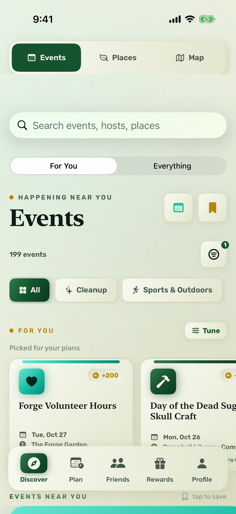
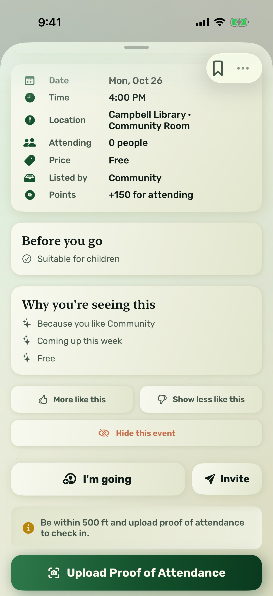
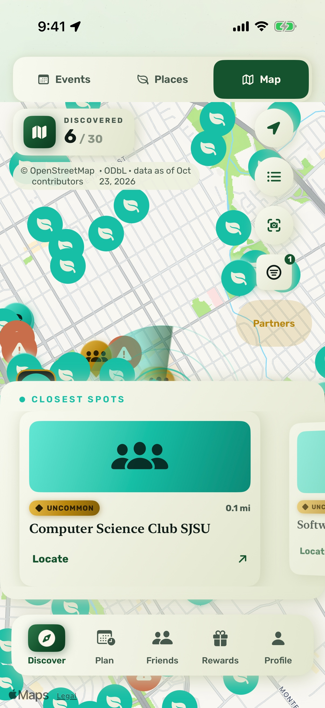
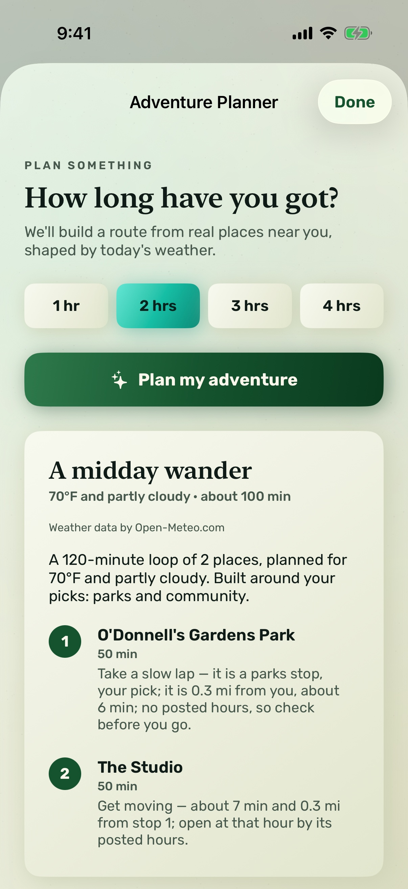

# Verdure

**Step Outside. Connect Within.**

An iOS app that turns your neighborhood into something worth exploring. Find the
parks, trails and community events around you, show up in person, and turn time
outside into real rewards.

<p>
  
  
  
  
</p>


## For Congressional App Challenge judges (CA-10, 2026)

- **Team:** Lalith, Rishit, John, Vishvak.
- **Source code:** this repository, `https://github.com/rishittiwari-rgb/verdure-cac-2026` (public).
- **Demonstration video (≤ 3 min):** [TEAM: paste the public YouTube/Vimeo link before submitting]
- **What it is, in one sentence:** Verdure rewards people for going outside and showing up at
  real local parks and community events, verified by location and photo.
- **Languages:** Swift (iOS app), TypeScript (Cloud Functions), Python (discovery reference
  engine).
- **AI assistance and third-party code:** fully disclosed in
  [`AI-AND-THIRD-PARTY-DISCLOSURE.md`](AI-AND-THIRD-PARTY-DISCLOSURE.md).
- **Run it yourself (Mac, Xcode 16+, Java 21, Node 20+):** `./run-all.command` starts the
  Firebase emulators with the saved data, loads the public events and park guides, and launches
  the app in the simulator. A fresh clone needs no keys: the script creates the two gitignored
  Firebase config files from their templates with placeholder values, which the local emulators accept. Sign in as `demo-judge@example.test` / `local-demo-walkthrough`.
  The backend is not deployed to the cloud (see *Deploy status* below), so the app needs the local
  stack to show data. Screenshots of every screen are in [`demo-screens/`](demo-screens/).
- **Where to read next:** [`docs/CAC-2026-SUBMISSION-REVIEW.md`](docs/CAC-2026-SUBMISSION-REVIEW.md)
  (rules and rubric check), [`FINAL-REPORT.md`](FINAL-REPORT.md) (what was built, with numbers).

---

## What it does

- **Discover** real nearby places from OpenStreetMap, the National Park Service
  and Recreation.gov, plus real community events.
- **Collect** places you actually visit — rarity tiers from Common parks to
  Legendary overlooks, gated on real GPS proximity.
- **Check in** at events to earn points. Attendance is verified with your
  location *and* a proof photo, validated server-side.
- **Progress** through streaks, monthly challenges and badges computed from what
  you genuinely did.
- **Redeem** points for gift cards, including limited-time seasonal drops.
- **Plan** an outing: the Adventure Planner builds an itinerary from real nearby
  places and today's weather (Open-Meteo), and the event planner sequences real
  events — both work with no AI key (a deterministic engine on the server).
- **Verdure+** (optional): unlimited planner (free members get 5 plans a month),
  early access to partner perks, cash gift cards, advanced stats.

## Design principles

Two rules shape most of the code:

1. **Nothing is fabricated.** If a data source doesn't provide a rating, review
   count, attendee number or opening hours, the app shows nothing rather than
   inventing a plausible number. Sample data exists only as a labelled cold-start
   fallback and is never mixed into real content.
2. **Points are server-authoritative.** The client never writes its own balance.
   Every earn and redemption goes through a Cloud Function; Firestore rules deny
   client writes to `pointsBalance`, `lifetimePoints`, `checkedInEventIDs`,
   `redeemedRewardIDs` and `plusExpiresAt`.

## Built with

| | |
|---|---|
| **Languages** | Swift (iOS app), TypeScript (Cloud Functions, Node 20), Python (the discovery reference engine in `reference/`) |
| **Apple frameworks** | SwiftUI, SceneKit, MapKit, CoreLocation, CoreMotion, PhotosUI, StoreKit 2 |
| **Libraries** | Firebase iOS SDK (Auth, Firestore, Functions, Storage, Messaging, Crashlytics); `firebase-admin`, `firebase-functions`, `@apple/app-store-server-library`, `sharp` |
| **Data** | OpenStreetMap (ODbL), Open-Meteo (CC BY 4.0), National Park Service and Recreation.gov APIs, public library, university, city and open-space calendars — credited in the app under Terms → Data and acknowledgements |
| **Fonts** | Fredoka and Rubik (SIL Open Font License) |
| **Tools** | Xcode, XcodeGen, Firebase Local Emulator Suite, Node/npm |
| **AI assistance** | Parts of the code, the tests and the documentation were written with an AI coding assistant (Claude Code); the sessions are recorded in [`CLAUDE.md`](CLAUDE.md), [`FINAL-REPORT.md`](FINAL-REPORT.md) and [`docs/MAC-VERIFICATION-2026-10-25.md`](docs/MAC-VERIFICATION-2026-10-25.md) |

## Architecture

```
Verdure/                    Xcode project (XcodeGen — edit project.yml, not the .xcodeproj)
  Verdure/
    Models/                 GameStateManager (@Observable), API services, GamificationEngine, StoreService
    Views/                  5 tabs: Discover (Events / Places / Map), Plan, Friends, Rewards, Profile
    Components/             ClayKit (claymorphism), ClayMotion, SceneKit medallion
    Theme/                  "Warm Forest" palette, Fredoka/Rubik type ramp
  VerdureTests/             Unit tests
  VerdureUITests/           Journey tests + Apple accessibility audits
functions/                  Cloud Functions (TypeScript, Node 20) — all point math and ingestion live here
  src/ingest/               Feed adapters (13), frozen classifier, annotate (adultOnly + topicTags),
                            listing checks, fuzzy dedupe, /sources registry with an absolute deny-list
  src/discovery/            Automatic source discovery: inspect, decide (six evidenced rules),
                            daily/weekly jobs, intake and removal endpoints
  src/ranking.ts / ranking-v2.ts   v1 ranker (live) and v2 (behind config/ranking, off)
  scripts/                  Unit suites, emulator E2Es, baseline, migrate-sources, seed-review-account
  seed/ranking-config.json  config/ranking seed;  discovery/model-urls.json  one discovery origin
  test-fixtures/            Recorded feeds and the 11,603-record corpus (tests never hit the internet)
docs/                       Surveys, audits, baselines, READ-BUDGET.md, GO-LIVE-CHECKLIST.md, sprint reports
reference/verdure-discovery/  John's Python engine, staged for porting
AppStore/                   Submission pack: listing copy, screenshots
firestore.rules             Production lockdown (incl. minor protection on /events)
firestore.indexes.json      Composite indexes — checked against every query shape by npm run check:indexes
storage.rules               Proof-photo ownership rules
```

**Where events come from.** Scheduled functions ingest the San Jose / South Bay
launch area from the active `/sources` documents (libraries, universities, city
and county calendars, open-space districts, Ticketmaster). The rule is in
`functions/src/ingest/areas.ts`: parse public feeds and open data freely, never
scrape a source whose terms prohibit it; Google Maps/Places, Meetup,
Facebook/Instagram, Eventbrite and ACTIVE Network are refused in code. New
sources are found automatically (`functions/src/discovery/`), inspected
against six rules with stored evidence, re-checked weekly, and removed on a
host's request. Every stored event carries `adultOnly` and `topicTags`; minors
and signed-out users never receive adult-only listings.

**Offline-first earning.** Check-ins apply optimistically, spool the proof photo
to disk, and queue a durable pending op. The queue replays automatically when
connectivity (and the backend) return — the callables are idempotent, so replays
are safe. The client only treats the server's balance as truth after a callable
has actually round-tripped, so an unreachable backend can never wipe local
progress.

## Running it

```bash
cd Verdure && xcodegen generate      # required after adding/removing files
open Verdure.xcodeproj               # ⌘R on an iPhone simulator (iOS 17+)
```

Firebase config lives in `Verdure/Secrets.xcconfig` (gitignored; copy the
`.template`). External data providers self-disable when their key is absent, so
the app runs without any keys.

**The whole stack in one step (macOS).** `./run-all.command` builds the backend,
starts the Firebase emulators with saved data, loads today's public events, park
guides and the demo accounts, then builds and launches the app on the simulator
(needs Xcode and Java 21; the header lists its flags). Sign in as
`demo-judge@example.test` / `local-demo-walkthrough`. Screenshots of every screen
are in [`demo-screens/`](demo-screens/).

With the stack running, ⌘R in Xcode also works: the scheme points the app at the
local emulators and loads `Verdure.storekit` (local test products for Verdure+).

## Testing

```bash
# iOS: unit + UI journeys + accessibility audits
cd Verdure && xcodebuild test -project Verdure.xcodeproj -scheme Verdure \
  -destination 'platform=iOS Simulator,name=iPhone 17 Pro'

# Backend: gates, units, then the server contract against local emulators (needs Java 21)
cd functions && npm run check:classifier && npm run check:indexes
cd functions && npm run test:units && npm run e2e && npm run redteam
cd functions && npm run e2e:ingest && npm run e2e:sources     # write-path metering, /sources registry
npx firebase-tools@13 emulators:exec --only firestore --project connectify-19dd8 \
  "node functions/scripts/discovery-e2e.mjs"                  # discovery / removal / self-healing (replays fixtures)
```

| Suite | Covers |
|---|---|
| iOS unit + UI + a11y | Transactions, cloud-merge safety, gamification, journeys across every tab, Apple accessibility audits, text-size matrix (needs Xcode) |
| Backend units (17 suites) | Fulfilment, subscriptions, ingest (adapters, annotate, listing checks, dedupe), ranking v1/v2, notifications, partners, planners, adventure engine, parks, offline, programs, place stories, rank eval, discovery, the local stack script |
| Backend E2E + red team | Rules lockdown and minor protection, check-in proof/GPS, Verdure+, redemption, fulfilment queue, rate limiting, attack suite |
| Ingest / sources / discovery E2E | Real SDK writes metered per collection, `/sources` migration parity, discovery decisions with evidence, removal, pause/resume |

Current counts are in [`FINAL-REPORT.md`](FINAL-REPORT.md) § 1.6 and
[`docs/MAC-VERIFICATION-2026-10-25.md`](docs/MAC-VERIFICATION-2026-10-25.md):
backend units 17 suites, E2E 363/363, red team 96 attacks blocked, acceptance
64/64, iOS unit 161/161, every UI class green (one partner-consent UI test is
intermittent, 6 of 8 runs; see the verification doc). Every backend number is from the local
emulator; the recorded corpus in `functions/test-fixtures/` replaces the live
internet in every test.

UI tests inject deterministic state through launch arguments (`-QATab`,
`-QAOfflineData`, `-QADisableMotion`) — see [`QA.md`](QA.md).

## Deploy status

⚠️ **Cloud Functions, Storage and the composite indexes are not deployed** — the
project is on the Spark plan and Functions require Blaze. Firestore rules *were*
live as of 2026-08-09, but `firestore.rules` has changed since (minor
protection, server-owned collections) and has not been redeployed. See the
verified status table in [`CLAUDE.md`](CLAUDE.md) (DEPLOY STATUS) for the live
facts and how to re-check them, and
[`docs/GO-LIVE-CHECKLIST.md`](docs/GO-LIVE-CHECKLIST.md) for the ordered paid
steps with costs and owners. Nothing on that checklist has been started.

```bash
npx firebase-tools@13 deploy --only firestore:rules     # works on Spark
npx firebase-tools@13 deploy --only firestore:indexes   # works on Spark
npx firebase-tools@13 deploy --only storage,functions   # needs Blaze + Storage init
```

## Docs

| File | What's in it |
|---|---|
| [`FINAL-REPORT.md`](FINAL-REPORT.md) | CAC 2026: every fix with its root cause and test, numbers before → after |
| [`docs/MAC-VERIFICATION-2026-10-25.md`](docs/MAC-VERIFICATION-2026-10-25.md) | The Mac run: fixes, iOS results, screenshots, open items |
| [`CLAUDE.md`](CLAUDE.md) | Architecture, design system, deploy status, changelog |
| [`QA.md`](QA.md) | Test strategy, QA harness, known issues |
| [`AppStore/LISTING.md`](AppStore/LISTING.md) | Listing copy, privacy label, review notes, blockers |
| [`SECURITY.md`](SECURITY.md) | Threat model and the reasoning behind each control |
| [`BACKEND.md`](BACKEND.md) | Cloud Functions and rules detail |
| [`docs/GO-LIVE-CHECKLIST.md`](docs/GO-LIVE-CHECKLIST.md) | Paid launch steps in order: cost, owner role, verify command |
| [`docs/FEED-SURVEY-SAN-JOSE.md`](docs/FEED-SURVEY-SAN-JOSE.md) | Launch-area sources, the sourcing rule, re-runnable probes |
| [`docs/READ-BUDGET.md`](docs/READ-BUDGET.md) | Firestore read scenario and the launch gate |
| [`docs/HALFWAY-REPORT-2026-10-18.md`](docs/HALFWAY-REPORT-2026-10-18.md) | Final-sprint halfway evidence (baselines, suites, deviations) |
